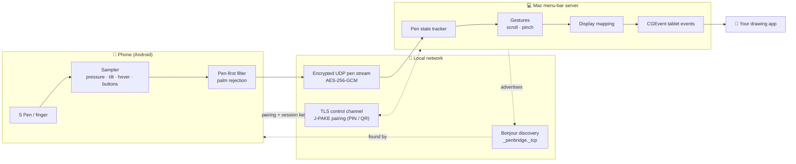
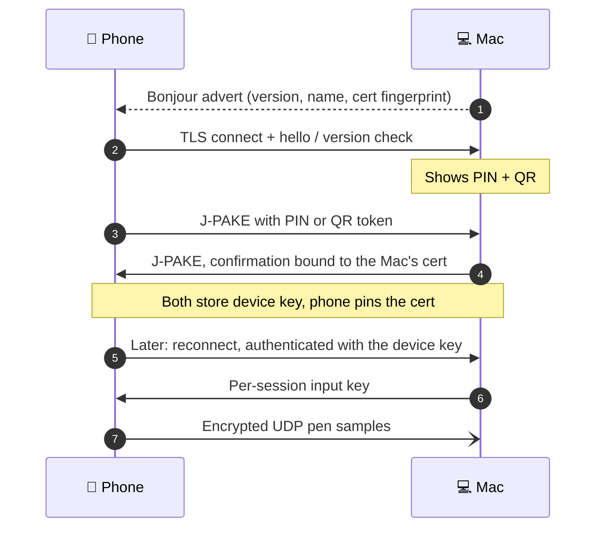

<div align="center">

# 🖊️ PenBridge

**Turn your phone into a pressure-sensitive drawing tablet for your Mac, over Wi-Fi.**

[](https://github.com/Blake11/PenBridge/actions/workflows/ci.yml)
[](LICENSE)
[](https://dotnet.microsoft.com/)
[](#requirements)
[](https://github.com/Blake11/PenBridge/releases/latest)
[](#status)

</div>

PenBridge pairs your Android phone with your Mac. A small menu-bar app on the Mac receives pen input (pressure, tilt, hover and the side button) and turns it into native tablet events, so your drawing app sees a real pen rather than a mouse. The main target device is a Samsung Galaxy S23 Ultra with its S Pen, but any phone works with a finger.

> 📸 Screenshots coming soon.

## How it works



1. **Discover.** The Mac advertises itself over Bonjour. The phone finds it, or you enter host and port by hand on networks without mDNS.
2. **Pair once.** The Mac shows a 6-digit PIN and a QR code. The phone proves it knows the secret with J-PAKE, and both sides store a device key.
3. **Draw.** Each stroke streams as small encrypted UDP datagrams. Every packet carries the full pen state, so a lost packet is corrected by the next one.
4. **Inject.** The Mac turns the stream into tablet proximity, down, drag and up events with pressure and tilt, mapped onto the display you choose.

<details>
<summary><b>Pairing and connecting, step by step</b></summary>



</details>

## Features

Everything marked ✅ works end to end, checked on a Galaxy S23 Ultra with a Mac. ⏳ is planned.

**Drawing**

- ✅ ✍️ **Pressure and tilt** from the S Pen, sent as native macOS tablet events
- ✅ 🫧 **Hover**: the cursor follows the pen before it touches the screen
- ✅ 🔘 **S Pen side button**: right-click while hovering, a right-button drag while the tip touches
- ✅ 🖐️ **Palm rejection**: pen first, so fingers and palms are ignored while the pen is near
- ✅ 👆 **Finger cursor mode**: one finger moves the cursor, tap to click, double-tap to double-click, double-tap and hold to drag. Switch it to **Draw** to paint with a finger instead
- ✅ ⚡ **Low latency** over UDP, keeping the S Pen's historical samples: about **3 ms** median and **8 ms** p95 from the phone sending a sample to the Mac injecting it, over Wi-Fi ([numbers](#how-fast-is-it))

**Phone app**

- ✅ 🔎 **Finds your Mac by itself** on the local network, and connects to the last Mac you used
- ✅ 📷 **Pair with a QR code or a PIN**; forget a Mac and re-pair it from Settings
- ✅ 🔁 **Reconnects** after Wi-Fi drops or when you come back to the app
- ✅ 🌫️ **Faint ink echo**: a short trail that fades, so you can see where the pen went
- ✅ 🟢 **Status dot** for the connection; tap it for latency, orientation, Disconnect and Change Mac
- ✅ 🔄 **Orientation toggle**: landscape (default), portrait or auto
- ✅ ⚙️ **Settings** for finger mode, finger pressure, finger hold before drawing and palm size
- ✅ 🙈 **No telemetry**: the app talks to your Mac and nothing else ([ADR-0020](docs/decisions.md#adr-0020--no-third-party-telemetry-strip-ml-kit-datatransport))

**Mac app**

- ✅ 🧭 **Menu-bar app** with no Dock icon: **run at startup**, a **pause hotkey** (⌃⌥⌘P), live connection stats, a display picker and **Open logs**
- ✅ 🔐 **Secure pairing** with a PIN or QR code (J-PAKE) in a floating window on the Mac, and **encryption** on every channel
- ✅ 🪶 **Light on the Mac**: a NativeAOT build with about a 20 MB footprint, a 168 ms launch and 0% CPU when idle
- ✅ 📲 **Multiple paired phones**; one draws at a time

**Next**

- ⏳ 🤏 **Two-finger scroll and pinch** gestures ([Phase 4](https://github.com/Blake11/PenBridge/issues/13))
- ⏳ 🗺️ **Region and button mapping** settings ([Phase 5](https://github.com/Blake11/PenBridge/issues/14))

## Status

**Beta, 1.0.0.** Phase 3 is done: a phone now draws on a Mac end to end. The Android client was verified on a Galaxy S23 Ultra against the release build of the Mac app ([#66](https://github.com/Blake11/PenBridge/issues/66)): discovery, QR and PIN pairing, pressure, tilt, hover, the side button, palm rejection, finger cursor mode and reconnecting all work, with no crashes. One known issue: a finger tap's click can be lost if its single datagram is dropped ([#92](https://github.com/Blake11/PenBridge/issues/92)).

| Phase | Scope | Status | Release |
|---|---|---|---|
| 0 | Repo bootstrap: conventions, CI/CD skeleton, toolchain | ✅ Done | |
| [1 — Core](https://github.com/Blake11/PenBridge/milestone/1) ([#10](https://github.com/Blake11/PenBridge/issues/10)) | Protocol, security, input processing, network engine and SimClient | ✅ Done | |
| [2 — Mac server](https://github.com/Blake11/PenBridge/milestone/2) ([#11](https://github.com/Blake11/PenBridge/issues/11)) | Menu bar, run at startup, pause hotkey, Bonjour, PIN/QR pairing window, Accessibility, CGEvent injector, NativeAOT | ✅ Done | |
| [3 — Android client](https://github.com/Blake11/PenBridge/milestone/3) ([#12](https://github.com/Blake11/PenBridge/issues/12)) | Drawing surface, S Pen, palm rejection, finger cursor mode, discovery, QR/PIN pairing, reconnect, on-device checks on the S23 Ultra | ✅ Done | **1.0.0** |
| [4 — Gestures](https://github.com/Blake11/PenBridge/milestone/4) ([#13](https://github.com/Blake11/PenBridge/issues/13)) | Two-finger scroll, pinch-zoom | ⏳ Planned | 1.1.0 |
| [5 — Settings](https://github.com/Blake11/PenBridge/milestone/5) ([#14](https://github.com/Blake11/PenBridge/issues/14)) | Display/region mapping, button mapping | ⏳ Planned | 1.2.0 |
| [Later](https://github.com/Blake11/PenBridge/milestone/7) ([#95](https://github.com/Blake11/PenBridge/issues/95)) | Android UX improvements: scope to be defined | ⏳ Later | |
| [Later](https://github.com/Blake11/PenBridge/milestone/7) | [Windows host](https://github.com/Blake11/PenBridge/issues/28), [iOS client](https://github.com/Blake11/PenBridge/issues/18), [screen mirroring](https://github.com/Blake11/PenBridge/issues/16), [DriverKit digitizer](https://github.com/Blake11/PenBridge/issues/17), [Air Actions](https://github.com/Blake11/PenBridge/issues/19), [trackpad mode](https://github.com/Blake11/PenBridge/issues/20), [notarization](https://github.com/Blake11/PenBridge/issues/21), [Google Play](https://github.com/Blake11/PenBridge/issues/22) | ⏳ Later | |

The MVP is phases 1–5. **Every phase ends with a release** on [GitHub Releases](https://github.com/Blake11/PenBridge/releases) ([ADR-0021](docs/decisions.md#adr-0021--release-at-the-end-of-every-phase-100--phase-3)): Phase 3 is **1.0.0**, the first release, and each later phase bumps the minor version. Bug-fix releases between phases bump the patch (1.1.1 …). All work is tracked in [issues](https://github.com/Blake11/PenBridge/issues) and [milestones](https://github.com/Blake11/PenBridge/milestones).

## Requirements

| | Minimum |
|---|---|
| 💻 Mac | macOS 14 (Sonoma) or later, Apple Silicon or Intel |
| 📱 Phone | Android 10 (API 29) or later |
| 🖊️ Stylus | Optional. Built and tested for the Galaxy S23 Ultra's S Pen; without one, a finger works |
| 📶 Network | Phone and Mac on the same local network |

## Getting started

### For users

Download both apps from the [latest release](https://github.com/Blake11/PenBridge/releases/latest):

| File | For |
|---|---|
| `PenBridge-X.Y.Z-macos.dmg` (or `.zip`) | the Mac menu-bar app |
| `PenBridge-X.Y.Z-android.apk` | the phone |
| `SHA256SUMS` | checking the downloads: `shasum -a 256 -c SHA256SUMS --ignore-missing` |

#### 1. Install the Mac app

The app is ad-hoc signed and not notarized yet ([#21](https://github.com/Blake11/PenBridge/issues/21)), so Gatekeeper warns on first launch:

1. Open the `.dmg` and drag **PenBridge** to **Applications**.
2. In Finder, **right-click PenBridge → Open → Open**. On macOS 15+, if there's no Open button, launch it once, then click **Open Anyway** in **System Settings → Privacy & Security**.
   Or, in Terminal: `xattr -dr com.apple.quarantine /Applications/PenBridge.app`
3. Grant **Accessibility** when PenBridge asks. It needs this to post pen events. After an update you may have to remove PenBridge from the Accessibility list and add it again.

PenBridge lives in the menu bar; there's no Dock icon.

#### 2. Install the phone app

The APK isn't on Google Play, so sideload it:

1. Download the `.apk` on the phone and open it.
2. Allow installs from your browser or Files app when Android asks, then tap **Install**. If Play Protect warns, choose **More details → Install anyway**.
   Or, from a computer: `adb install -r PenBridge-X.Y.Z-android.apk`

#### 3. Pair and draw

1. Put the phone and the Mac on the same network.
2. On the Mac, choose **Pair new device…** from the PenBridge menu. A window shows a QR code and a 6-digit PIN.
3. Open PenBridge on the phone. Your Mac shows up in the list: pick it and scan the QR code, or type the PIN.
4. Draw. Next time, the phone connects to that Mac by itself.

Open a pressure-aware app such as Krita to see pressure and tilt. More details are in [docs/releasing.md](docs/releasing.md#installing-the-android-apk-sideload) and [macOS signing](docs/releasing.md#macos-signing).

### For developers

```bash
scripts/bootstrap.sh     # install the toolchain (prints any sudo steps for you)
scripts/doctor.sh        # check .NET, workloads, Xcode, Android SDK and devices
scripts/test.sh          # Core tests: fast, any OS, no workloads needed
dotnet build PenBridge.slnx

scripts/mac-dev-cert.sh  # one-time: stable signing cert, keeps the Accessibility grant
scripts/mac-run.sh       # build, sign and launch the menu-bar app
scripts/android-run.sh   # build and run on the emulator or a phone
```

### Read more

- [docs/development.md](docs/development.md): toolchain setup, building, running and debugging on each platform
- [CONTRIBUTING.md](CONTRIBUTING.md): branches, Conventional Commits, pull requests
- [docs/architecture.md](docs/architecture.md) and [docs/decisions.md](docs/decisions.md): the design and the decisions behind it
- [docs/specs/](docs/specs): the wire protocol and Core spec, and the Mac server and Android client specs

## Try without a phone

No phone at hand? [`tools/PenBridge.SimClient`](tools/PenBridge.SimClient) stands in for one: it pairs with the PIN like a real device and streams scripted strokes to the Mac server. It runs from a clone of the repo (see [For developers](#for-developers)).

```bash
scripts/mac-run.sh       # launch the server, grant Accessibility, then choose "Pair new device…"

# in another terminal, with the PIN from the pairing window
dotnet run --project tools/PenBridge.SimClient -- pair --host 127.0.0.1 --pin <PIN>
dotnet run --project tools/PenBridge.SimClient -- draw circle    # or pressure-ramp, tilt-sweep, hover, button-click
dotnet run --project tools/PenBridge.SimClient -- scripts        # list every draw script
```

Open a pressure-aware app such as Krita first to watch the strokes arrive.

## Security at a glance

A paired phone controls your pointer, so PenBridge treats pairing as the front door.

- 🔑 **Only paired devices can inject input.** Pairing uses J-PAKE with the PIN or a one-time QR token, so the secret never crosses the network ([ADR-0009](docs/decisions.md#adr-0009--pinqr-pairing-via-j-pake-bouncycastle-bound-to-the-macs-tls-certificate)).
- 🧷 **No man in the middle.** Pairing confirmation is bound to the Mac's certificate, and the phone pins that certificate for every later connection.
- 🔒 **Everything is encrypted.** Control messages go over TLS 1.2+, and every pen datagram is AES-256-GCM with a fresh key per session ([ADR-0004](docs/decisions.md#adr-0004--bonjour-discovery-pinqr-pairing-tls-control--encrypted-udp-input), [ADR-0013](docs/decisions.md#adr-0013--control-channel-accepts-tls-12-supersedes-the-tls-13-detail-of-adr-0004)).
- 🚫 **No plaintext fallback.** Replayed, tampered or stale packets are dropped, and PINs expire after 2 minutes or 3 wrong tries.

## Project layout

```
PenBridge.slnx
├── src/
│   ├── PenBridge.Core/       platform-free: protocol, crypto, pairing, mapping, gestures
│   ├── PenBridge.Mac/        menu-bar server and CGEvent tablet injector
│   ├── PenBridge.Android/    client: drawing surface, S Pen, discovery, pairing
│   └── PenBridge.iOS/        placeholder only
├── tests/PenBridge.Core.Tests/   xUnit v3, runs anywhere
├── tools/PenBridge.SimClient/    fake phone: pairs and draws scripted strokes
├── scripts/                  bootstrap, doctor, test, mac-*, android-*
└── docs/                     architecture, decisions (ADRs), specs, development
```

## FAQ

**Does it work with Krita or Photoshop?**
Krita, yes. It's the reference app, and pressure, tilt, hover and the side button from a real S Pen were checked in it during the [on-device verification](https://github.com/Blake11/PenBridge/issues/66). PenBridge posts standard macOS tablet events, which other pressure-aware apps read too, but Photoshop hasn't been tested.

<a id="how-fast-is-it"></a>**How fast is it?**
Measured on a Galaxy S23 Ultra over Wi-Fi in a 30-second scribble (about 56,000 samples), from the phone sending a sample to the Mac injecting it: about **3 ms** median and **8 ms** p95. For the first sample of a stroke (pen down), about **4 ms** median and **14 ms** p95. Wi-Fi adds the occasional spike of around 100 ms.

**Why Wi-Fi and not USB?**
Wireless is the point: no cable between you and the canvas. Pen samples are tiny and sent over UDP to keep latency low. A wired mode isn't on the roadmap today.

**What about iPhone and iPad?**
There's an iOS placeholder project, and an [iOS client](https://github.com/Blake11/PenBridge/issues/18) is planned for later, after the Android MVP.

## License

[MIT](LICENSE) © 2026 Paul Ciurea
