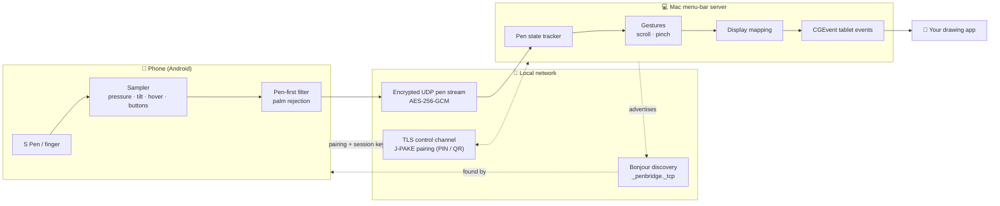
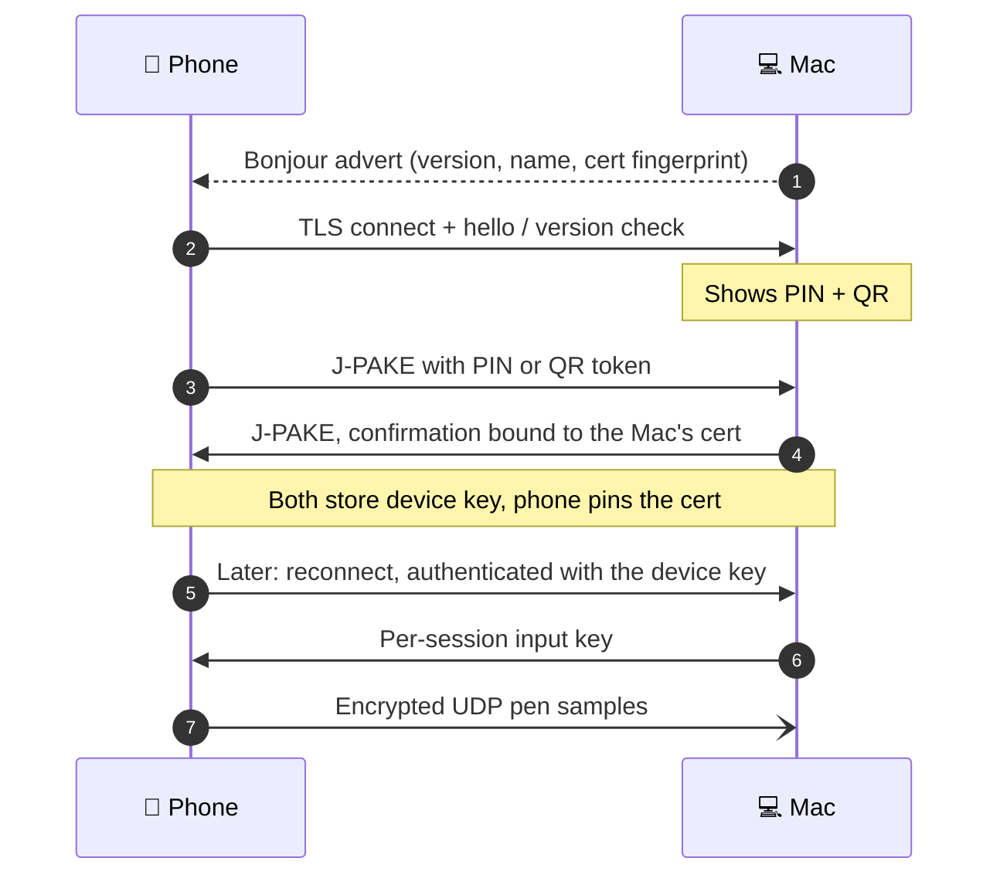

<div align="center">

# 🖊️ PenBridge

**Turn your phone into a pressure-sensitive drawing tablet for your Mac, over Wi-Fi.**

[](https://github.com/Blake11/PenBridge/actions/workflows/ci.yml)
[](LICENSE)
[](https://dotnet.microsoft.com/)
[](#requirements)
[](#status)

</div>

PenBridge pairs your Android phone with your Mac. A small menu-bar app on the Mac receives pen input (pressure, tilt, hover and the side button) and turns it into native tablet events, so your drawing app sees a real pen rather than a mouse. The main target device is a Samsung Galaxy S23 Ultra with its S Pen, but any phone works with a finger.

> 📸 Screenshots coming with the first release.

## How it works



1. **Discover.** The Mac advertises itself over Bonjour. The phone finds it, or you enter host and port by hand on networks without mDNS.
2. **Pair once.** The Mac shows a 6-digit PIN and a QR code. The phone proves it knows the secret with J-PAKE, and both sides store a device key.
3. **Draw.** Each stroke streams as small encrypted UDP datagrams. Every packet carries the full pen state, so a lost packet is corrected by the next one.
4. **Inject.** The Mac turns the stream into tablet proximity, down, drag and up events with pressure and tilt, mapped onto the display you choose.

<details>
<summary><b>Pairing and connecting, step by step</b></summary>



</details>

## Features

The Mac server is built, and so is the phone's drawing pad. The phone's connect screens are next, so a real phone can't pair yet (see [Status](#status)). ✅ is built, ⏳ is planned.

- ✅ ✍️ **Pressure and tilt** from the S Pen, sent as native macOS tablet events
- ✅ 🫧 **Hover**: the cursor follows the pen before it touches the screen
- ✅ 🔘 **S Pen side button**, mapped to right-click by default
- ✅ 🖐️ **Palm rejection**: pen first, so fingers and palms are ignored while the pen is near
- ✅ 👆 **Finger fallback** when there's no stylus
- ✅ 🧭 **Menu-bar app** with no Dock icon: **run at startup**, a **pause hotkey** (⌃⌥⌘P), live connection stats, a display picker and **Open logs**
- ✅ 🔐 **Secure pairing** with a PIN or QR code (J-PAKE) in a floating window on the Mac, and **encryption** on every channel
- ✅ ⚡ **Low latency** over UDP, keeping the S Pen's historical samples
- ✅ 🪶 **Light on the Mac**: a NativeAOT build with about a 20 MB footprint, a 168 ms launch and 0% CPU when idle
- ✅ 📲 **Multiple paired phones**; one draws at a time
- ⏳ 🤏 **Two-finger scroll and pinch** gestures ([Phase 4](https://github.com/Blake11/PenBridge/issues/13))
- ⏳ 🗺️ **Region and button mapping** settings ([Phase 5](https://github.com/Blake11/PenBridge/issues/14))

## Status

**Pre-alpha.** The shared Core library and the Mac menu-bar server are done, and you can [try the server today](#try-the-mac-server-without-a-phone) with a simulated phone. The Android app already draws, with S Pen pressure, tilt, hover and palm rejection. Its connect screens are still being built, so it doesn't work end to end on a real phone yet.

| Phase | Scope | Status |
|---|---|---|
| 0 | Repo bootstrap: conventions, CI/CD skeleton, toolchain | ✅ Done |
| [1 — Core](https://github.com/Blake11/PenBridge/milestone/1) ([#10](https://github.com/Blake11/PenBridge/issues/10)) | Protocol, security, input processing, network engine and SimClient | ✅ Done |
| [2 — Mac server](https://github.com/Blake11/PenBridge/milestone/2) ([#11](https://github.com/Blake11/PenBridge/issues/11)) | Menu bar, run at startup, pause hotkey, Bonjour, PIN/QR pairing window, Accessibility, CGEvent injector, NativeAOT | ✅ Done |
| [3 — Android client](https://github.com/Blake11/PenBridge/milestone/3) ([#12](https://github.com/Blake11/PenBridge/issues/12)) | Drawing surface, S Pen ✅, Keystore, discovery, ClientHost ✅, palm rejection ✅, connect screens 🚧 ([#65](https://github.com/Blake11/PenBridge/issues/65)), on-device checks 🚧 ([#66](https://github.com/Blake11/PenBridge/issues/66)) | 🚧 In progress |
| [4 — Gestures](https://github.com/Blake11/PenBridge/milestone/4) ([#13](https://github.com/Blake11/PenBridge/issues/13)) | Two-finger scroll, pinch-zoom | ⏳ Planned |
| [5 — Settings](https://github.com/Blake11/PenBridge/milestone/5) ([#14](https://github.com/Blake11/PenBridge/issues/14)) | Display/region mapping, button mapping | ⏳ Planned |
| [6 — Release](https://github.com/Blake11/PenBridge/milestone/6) ([#15](https://github.com/Blake11/PenBridge/issues/15)) | Mac `.dmg` and Android APK on GitHub Releases | ⏳ Planned |
| [Later](https://github.com/Blake11/PenBridge/milestone/7) | [Windows host](https://github.com/Blake11/PenBridge/issues/28), [iOS client](https://github.com/Blake11/PenBridge/issues/18), [screen mirroring](https://github.com/Blake11/PenBridge/issues/16), [DriverKit digitizer](https://github.com/Blake11/PenBridge/issues/17), [Air Actions](https://github.com/Blake11/PenBridge/issues/19), [trackpad mode](https://github.com/Blake11/PenBridge/issues/20), [notarization](https://github.com/Blake11/PenBridge/issues/21), [Google Play](https://github.com/Blake11/PenBridge/issues/22) | ⏳ Later |

The MVP is phases 1–5. All work is tracked in [issues](https://github.com/Blake11/PenBridge/issues) and [milestones](https://github.com/Blake11/PenBridge/milestones).

## Requirements

| | Minimum |
|---|---|
| 💻 Mac | macOS 14 (Sonoma) or later, Apple Silicon or Intel |
| 📱 Phone | Android 10 (API 29) or later |
| 🖊️ Stylus | Optional. Built and tested for the Galaxy S23 Ultra's S Pen; without one, a finger works |
| 📶 Network | Phone and Mac on the same local network |

## Getting started

### For users

> ⏳ **Coming soon:** builds will be published on [GitHub Releases](https://github.com/Blake11/PenBridge/releases) once Phase 6 lands.

The Mac app will be ad-hoc signed and not notarized at first, so Gatekeeper warns on first launch. To open it:

1. Open the `.dmg` and drag **PenBridge** to **Applications**.
2. In Finder, **right-click PenBridge → Open → Open**. On macOS 15+, if there's no Open button, launch it once, then click **Open Anyway** in **System Settings → Privacy & Security**.
   Or, in Terminal: `xattr -dr com.apple.quarantine /Applications/PenBridge.app`
3. Grant **Accessibility** when PenBridge asks. It needs this to post pen events.

Details are in [docs/releasing.md](docs/releasing.md#macos-signing).

### For developers

```bash
scripts/bootstrap.sh     # install the toolchain (prints any sudo steps for you)
scripts/doctor.sh        # check .NET, workloads, Xcode, Android SDK and devices
scripts/test.sh          # Core tests: fast, any OS, no workloads needed
dotnet build PenBridge.slnx

scripts/mac-dev-cert.sh  # one-time: stable signing cert, keeps the Accessibility grant
scripts/mac-run.sh       # build, sign and launch the menu-bar app
scripts/android-run.sh   # build and run on the emulator or a phone
```

### Try the Mac server without a phone

The menu-bar server runs today. Until the Android connect screens land, [`tools/PenBridge.SimClient`](tools/PenBridge.SimClient) stands in for the phone: it pairs with the PIN like a real device and streams scripted strokes.

```bash
scripts/mac-run.sh       # launch the server, grant Accessibility, then choose "Pair new device…"

# in another terminal, with the PIN from the pairing window
dotnet run --project tools/PenBridge.SimClient -- pair --host 127.0.0.1 --pin <PIN>
dotnet run --project tools/PenBridge.SimClient -- draw circle    # or pressure-ramp, tilt-sweep, hover, button-click
dotnet run --project tools/PenBridge.SimClient -- scripts        # list every draw script
```

Open a pressure-aware app such as Krita first to watch the strokes arrive.

### Read more

- [docs/development.md](docs/development.md): toolchain setup, building, running and debugging on each platform
- [CONTRIBUTING.md](CONTRIBUTING.md): branches, Conventional Commits, pull requests
- [docs/architecture.md](docs/architecture.md) and [docs/decisions.md](docs/decisions.md): the design and the decisions behind it
- [docs/specs/](docs/specs): the wire protocol and Core spec, and the Mac server and Android client specs

## Security at a glance

A paired phone controls your pointer, so PenBridge treats pairing as the front door.

- 🔑 **Only paired devices can inject input.** Pairing uses J-PAKE with the PIN or a one-time QR token, so the secret never crosses the network ([ADR-0009](docs/decisions.md#adr-0009--pinqr-pairing-via-j-pake-bouncycastle-bound-to-the-macs-tls-certificate)).
- 🧷 **No man in the middle.** Pairing confirmation is bound to the Mac's certificate, and the phone pins that certificate for every later connection.
- 🔒 **Everything is encrypted.** Control messages go over TLS 1.2+, and every pen datagram is AES-256-GCM with a fresh key per session ([ADR-0004](docs/decisions.md#adr-0004--bonjour-discovery-pinqr-pairing-tls-control--encrypted-udp-input), [ADR-0013](docs/decisions.md#adr-0013--control-channel-accepts-tls-12-supersedes-the-tls-13-detail-of-adr-0004)).
- 🚫 **No plaintext fallback.** Replayed, tampered or stale packets are dropped, and PINs expire after 2 minutes or 3 wrong tries.

## Project layout

```
PenBridge.slnx
├── src/
│   ├── PenBridge.Core/       platform-free: protocol, crypto, pairing, mapping, gestures
│   ├── PenBridge.Mac/        menu-bar server and CGEvent tablet injector
│   ├── PenBridge.Android/    client: drawing surface, S Pen, discovery, pairing
│   └── PenBridge.iOS/        placeholder only
├── tests/PenBridge.Core.Tests/   xUnit v3, runs anywhere
├── tools/PenBridge.SimClient/    fake phone: pairs and draws scripted strokes
├── scripts/                  bootstrap, doctor, test, mac-*, android-*
└── docs/                     architecture, decisions (ADRs), specs, development
```

## FAQ

**Does it work with Krita or Photoshop?**
That's the goal. PenBridge posts standard macOS tablet events with pressure and tilt, which pressure-aware apps such as Krita read, and Krita is the reference app for testing. A full check with a real S Pen is part of the [on-device verification](https://github.com/Blake11/PenBridge/issues/66).

**Why Wi-Fi and not USB?**
Wireless is the point: no cable between you and the canvas. Pen samples are tiny and sent over UDP to keep latency low. A wired mode isn't on the roadmap today.

**What about iPhone and iPad?**
There's an iOS placeholder project, and an [iOS client](https://github.com/Blake11/PenBridge/issues/18) is planned for later, after the Android MVP.

## License

[MIT](LICENSE) © 2026 Paul Ciurea
